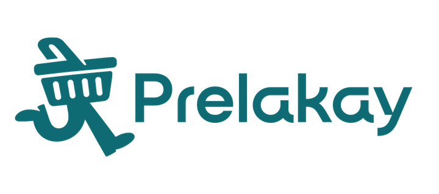
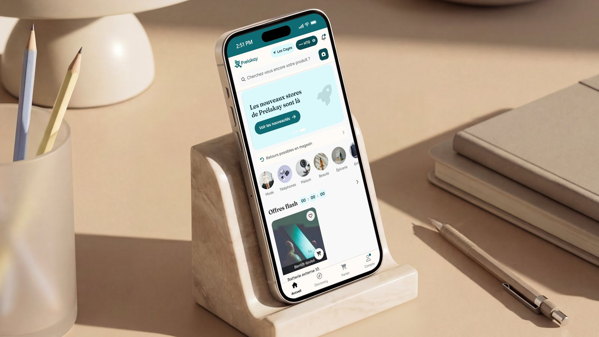
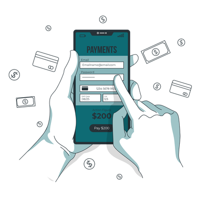
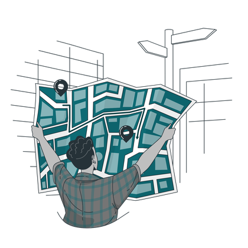
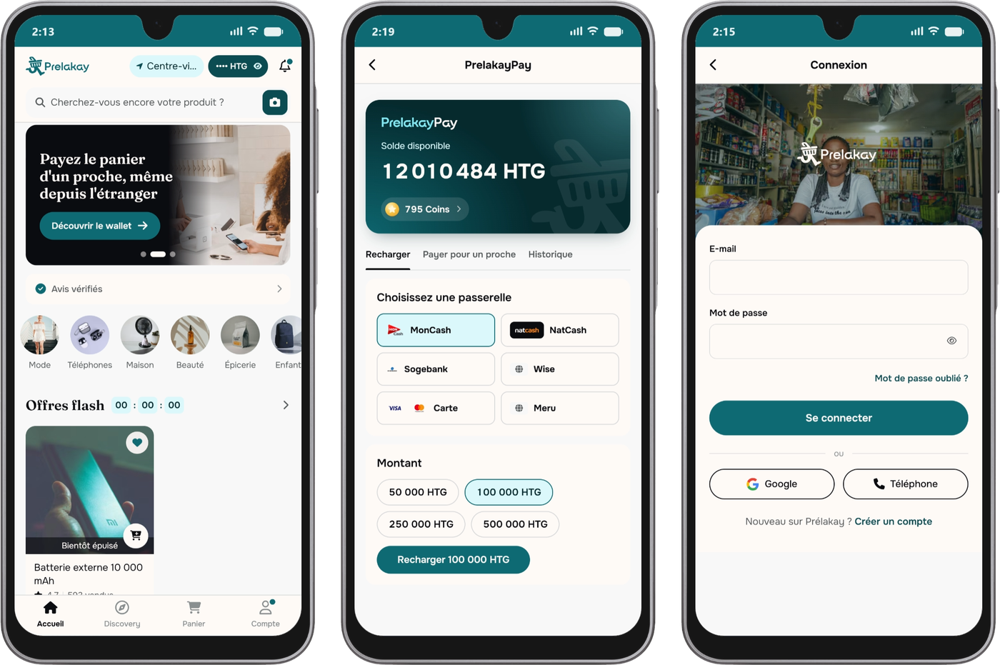
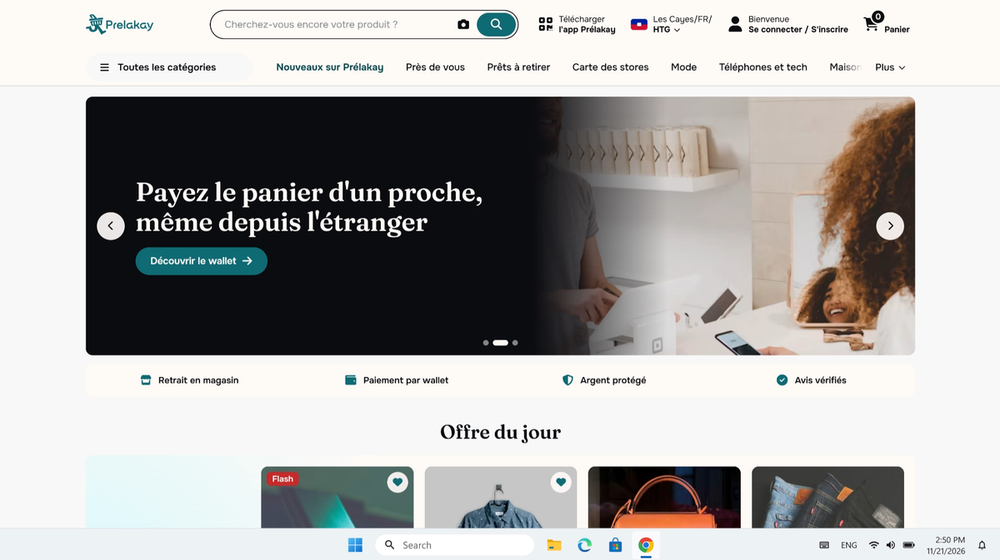

<div align="center">

<picture>
  <source media="(prefers-color-scheme: dark)" srcset="_README/assets/logo-blanc.png">
  
</picture>

### Les boutiques de votre ville, dans votre poche

Commandez en ligne auprès des commerces près de chez vous, retirez au comptoir ou faites-vous livrer.<br>
Votre argent reste protégé jusqu'à ce que vous ayez votre article en main.

<br>

[](https://app.prelakay.com)
[](https://vendeur.prelakay.com)
[](https://www.prelakay.com)

</div>

<br>

<p align="center">
  
</p>

---

## Acheter près de chez soi, en toute confiance

Les meilleures boutiques sont souvent dans la rue d'à côté, mais rien ne dit ce qu'elles ont en stock, ni comment payer à distance sans risque. Prélakay met leur catalogue en ligne, protège chaque paiement et vous laisse choisir : passer au comptoir ou recevoir la commande.

<table>
  <tr>
    <td width="50%" valign="top">
      <br>
      <b>Retrait en magasin</b><br>
      Commandez en ligne, passez au comptoir avec votre code de retrait. Le store prépare, vous récupérez, sans attendre.
    </td>
    <td width="50%" valign="top">
      <br>
      <b>PrelakayPay</b><br>
      Un wallet en gourdes, rechargé par MonCash, NatCash ou carte bancaire. Payer devient un geste, sans liquide.
    </td>
  </tr>
  <tr>
    <td width="50%" valign="top">
      <br>
      <b>Livraison</b><br>
      Pas le temps de passer ? Un livreur partenaire apporte la commande, avec une preuve de remise.
    </td>
    <td width="50%" valign="top">
      <br>
      <b>Les stores près de vous</b><br>
      Chaque produit affiche son store et sa distance. La carte montre ce qui est disponible autour de vous.
    </td>
  </tr>
</table>

---

## Les écrans

<p align="center">
  
</p>

<p align="center"><sub>Accueil · PrelakayPay · Connexion</sub></p>

L'application s'installe depuis le navigateur, comme une app. Elle tient sur les petits écrans et reste légère sur une connexion mobile ordinaire.

<p align="center">
  
</p>

<p align="center"><sub>Sur ordinateur : les stores près de chez vous, dès la connexion</sub></p>

---

## Ce que Prélakay vous apporte

### Pour les acheteurs

- **Argent protégé** : le store n'est payé qu'une fois l'article retiré ou livré.
- **Avis vérifiés** : seuls les clients qui ont reçu leur commande peuvent noter.
- **Retours possibles en magasin**, et remboursement sur votre wallet.
- **Coins** à chaque commande, à utiliser sur les suivantes.
- **Offres flash, coupons et events** des stores de votre ville.
- **Recherche par photo ou par la voix** : montrez ou dites ce que vous cherchez.
- **Prélakay+** : badge or, réductions réservées, accès anticipé aux events et Coins en bonus.

### Pour la diaspora

- **Payez le panier d'un proche, même depuis l'étranger** : il prépare son panier et vous envoie un lien, vous réglez en un geste.
- Le proche retire en magasin, près de chez lui. Vous savez où va votre argent.

### Pour les commerçants

- **Une vitrine en ligne** sans site à construire : catalogue, variantes, stock par taille et couleur.
- **Des clients du quartier** qui viennent au comptoir, prêts à payer.
- **Commandes, préparation et retraits** suivis au même endroit, avec un code de retrait à valider.
- **Marketing intégré** : coupons, offres flash, participation aux events, mise en avant des produits.
- **Store de confiance** : un score de santé du store qui récompense le sérieux par un argent libéré plus vite.
- **Statistiques claires** : ventes, produits phares, taux de retrait.

[](https://vendeur.prelakay.com)

---

## La marque

Lagon profond, papier chaud et un panier qui court : une identité pensée pour la rue autant que pour l'écran.

<p align="center">
  
</p>

---

## Feuille de route

- ✅ Prototype complet (acheteur, vendeur, admin) sur données de démonstration
- ✅ Gestion type AliExpress : events, règles de commission datées, publicité, notifications
- ✅ PrelakayPay, Prélakay+, Prélakay Import (catalogue), logique métier en modules purs
- 🔜 Branchement Supabase, domaine par domaine
- 🔜 [Landing page](landing/PLAN.md) (`www.prelakay.com`) — plan de préparation en cours, construction après le PWA

Détail : `CHANGELOG.md` (ce qui marche dans chaque version) et `docs/06-plan.md` (ordre de construction).

---

## Liens

| | |
| --- | --- |
| Application | [https://app.prelakay.com](https://app.prelakay.com) |
| Espace vendeur | [https://vendeur.prelakay.com](https://vendeur.prelakay.com) |
| Site | [https://www.prelakay.com](https://www.prelakay.com) |
| Code source | [https://github.com/mrsaget2003/Prelakay-web](https://github.com/mrsaget2003/Prelakay-web) |

---

<details>
<summary><b>Pour les développeurs</b></summary>

<br>

Une application Next.js 16 (React 19, TypeScript), trois déploiements indépendants. La variable `APP_SPACE` limite les routes servies par chacun.

| Espace | Branche | Domaine | `APP_SPACE` |
| --- | --- | --- | --- |
| Application acheteur | `PWA` | [https://app.prelakay.com](https://app.prelakay.com) | `acheteur` |
| Espace vendeur | `dashSeller` | [https://vendeur.prelakay.com](https://vendeur.prelakay.com) | `vendeur` |
| Espace admin (sans SEO) | `dashAdmin` | [https://admin.prelakay.com](https://admin.prelakay.com) | `admin` |

`main` est le tronc de travail ; chaque espace abouti est fusionné dans sa branche.

```bash
git clone https://github.com/mrsaget2003/Prelakay.git
cd Prelakay
npm install
cp .env.example .env.local   # renseigner les clés (aucune n'est dans le code)
npm run dev                  # http://localhost:3000
```

`npm test` (Vitest), `npm run test:e2e` (Playwright), `npm run typecheck`, `npm run lint`.

Pile : Supabase (Postgres, accès côté serveur), Serwist (PWA), MapLibre + MapTiler, Nivo, Motion, Zod, Gemini côté serveur. La logique métier vit dans des modules purs de `lib/domain/`, `lib/events/` et `lib/config/`, testés sans dépendance.

</details>
